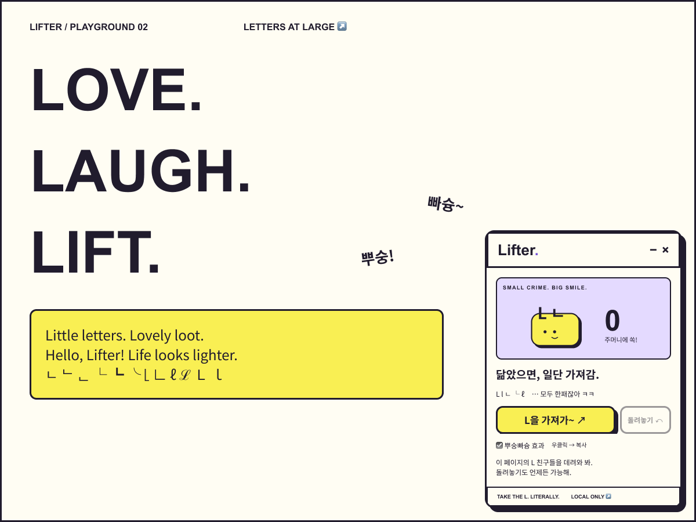

<p align="center"></p>
<h1 align="center">Lifter. — L을 가져가~</h1>
<p align="center"><b>A tiny heist. A pocket full of Ls.</b><br>웹페이지의 L을 주머니에 쏙. 정말로 가져가는 확장 프로그램.</p>

## 바로 사용하기
1. [설치 ZIP 다운로드](https://github.com/hslcrb/lifter/raw/refs/heads/main/dist/lifter-2.0.0.zip) 후 압축을 풉니다.
2. Chrome의 `chrome://extensions` 또는 Edge의 `edge://extensions`에서 개발자 모드를 켭니다.
3. **압축해제된 확장 프로그램을 로드** → `manifest.json`이 있는 폴더를 선택합니다.
4. 일반 웹사이트에서 Lifter 아이콘을 누르면 **사이트 위에 플로팅 패널**이 나타납니다. **L을 가져가~**를 누르세요.
5. **돌려놓기** 또는 새로고침으로 원상복구합니다.

v1에서 업데이트했다면 확장 관리 화면에서 새로고침한 뒤, 열려 있던 웹페이지도 새로고침하세요.

스토어에 게시된 제품은 아닙니다. 소스 ZIP을 받은 경우에는 `extension/` 폴더를 선택하세요.

## 작은 장난, 꼼꼼한 동작
- **L · l · ㄴ**은 무조건 한패. 전각·수학체 L, ℓ/ℒ/Ⅼ, ㄴ/ᄂ/ᆫ/ﾤ, └/┗/╰/⌊/∟ 및 라틴 L 악센트 변형도 수집합니다. 숫자 1, 대문자 I, 한글 음절은 그대로 둡니다.
- 툴바 팝업 없이 사이트 위에 계속 떠 있습니다. 접기·닫기를 지원하고 툴바로 다시 열 수 있습니다.
- 글자 팝 → 휘어지는 비행 → 뿌숭/빠슝 말풍선 → 주머니 충격파와 축포. 비행은 최대 24개, 축포는 28개로 제한합니다.
- 패널 내부는 평소 선택·드래그가 잠겨 있습니다. **우클릭 → 복사 — 형광펜 모드**에서 드래그 선택 후 Ctrl/Cmd+C 또는 복사 버튼을 누르면 축포! 실제 복사 성공 시에만 표시합니다.
- 링크 주소, 입력값, 편집 영역, 스크립트, SVG와 캔버스는 그대로 둡니다.
- 원래 텍스트 노드와 이벤트를 유지합니다. 복원 중 사이트가 수정한 내용은 덮어쓰지 않습니다.
- 동적으로 나타난 글자는 다시 클릭해서 수집합니다. 열린 Shadow DOM도 지원합니다.
- OS의 모션 감소 설정을 존중합니다. 효과를 직접 끌 수도 있습니다.
- 웹페이지 내용은 전송하지 않습니다. [개인정보 안내](docs/PRIVACY.md)

## 범위
렌더링되는 DOM 텍스트가 대상입니다. 이미지 속 L, CSS 가상 요소, 닫힌 Shadow DOM, 다른 프레임은 대상이 아닙니다. 브라우저 내부 화면, 웹 스토어, 일부 보호된 페이지에서는 작동하지 않습니다. 새로고침·이동하면 패널과 수집 기록은 초기화됩니다. 툴바를 다시 눌러 패널을 띄우세요. 웹 앱이 직접 내용을 다시 렌더링하면 L이 돌아올 수 있습니다.

## Design is the UI
[Figma — Brand, UI & Motion](https://www.figma.com/design/ncTskVmL3IvqYAy95YGjnx)

Ordo Novus → Creatively → **Lifter — L을 가져가**. 편집 가능한 브랜드 보드, 컬러/간격/테두리/모션 변수, 버튼 베리언트, 주머니 컴포넌트, 준비·수집·형광펜 플로팅 패널과 웹사이트 위 배치을 제공합니다.




레몬 `#F9EF53` · 바이올렛 `#7654D6` · 잉크 `#211C2D` · 페이퍼 `#FFFDF3` · 라일락 `#E4DAFF`.

GSAP의 로컬 번들 사용은 가능하지만, 이번에는 720ms 글자 비행과 유한한 타이밍의 충격파·말풍선·축포를 구현하기에 **CSS + Web Animations API**를 선택했습니다. 원격 코드, 무한 바운스, 장식용 파티클 루프가 없습니다.

## 개발 / 체험
```sh
npm ci
npm test
python3 scripts/package.py
python3 -m http.server 8765
```
`http://localhost:8765/docs/demo/`에서 설치 없이 같은 엔진으로 수집·복원을 체험합니다. 체험판도 실제 `extension/panel.js`를 그대로 사용합니다. 테스트는 jsdom에서 실행되며 실제 브라우저의 확장 권한을 대체하지 않습니다.

## 밈 크레딧
‘L을 가져가’ / Take the L, 권루트의 라이벌 이모트 영상에서 퍼진 장난을 문자 그대로 해석했습니다. 캐릭터·음원·영상은 가져오지 않고 독자적인 주머니 그래픽을 만들었습니다.
- [인크로스 마인뉴스 — 밈 맥락](https://minenews.stibee.com/p/585/)
- [캐릿 — Take the L 설명](https://www.careet.net/2008)

[설계](docs/superpowers/specs/2026-10-27-lifter-design.md) · [검증](docs/VERIFICATION.md)
