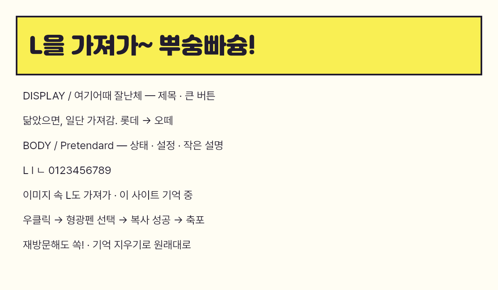

# Typeface family

Inspected on Noonnu: [Jalnan](https://noonnu.cc/font_page/115) and [Pretendard](https://noonnu.cc/font_page/694), including on-page specimens, weights and original license links.

- Titles and main action: here/how's **여기어때 잘난체**, original WOFF bundled as LifterJalnan. Rounded heavy forms match the chunky yellow/purple pocket branding.
- Body, settings and small controls: **Pretendard Regular / Bold**, original WOFF2, CSS family alias LifterPretendard. Korean and Latin align more cleanly at small sizes.
- Fallback: Arial/system sans-serif for unsupported symbols. The fonts affect only Lifter, never the host website.
- `FontFace` loads packaged bytes into the document font set; no runtime font CDN requests.
- Full original notices: `extension/assets/fonts/`. Jalnan is unmodified and bundled with the publisher's PDF; Pretendard includes the SIL OFL.
- Figma's tool renderer currently lacks both families. Editable labels use Noto Sans KR and are explicitly annotated as fallback. Exact font specimen is included below. No claim that the Figma fallback typography is identical to installed UI.

Rendering this specimen optionally requires Python fontTools and @napi-rs/canvas. Font conversion is temporary for the test renderer; redistributed WOFF/WOFF2 files are unchanged.
